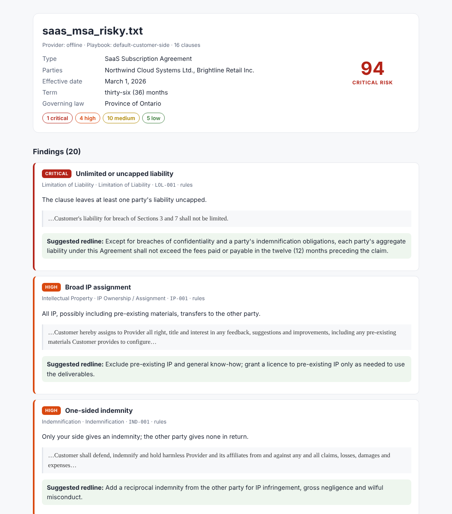
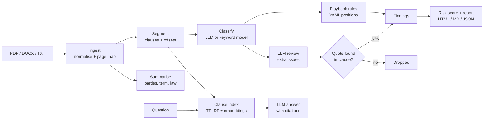

# ⚖️ ContractLens: LLM-Powered Legal Contract Review

> Upload a contract. Get clause-by-clause risk findings, suggested redlines, a 0–100 risk score, and a chat that answers questions with citations to the exact clause.

   

Lawyers and founders spend hours reading vendor paper to find the five clauses that matter. ContractLens does the first pass in seconds. It splits the contract into clauses, classifies each one (41-category CUAD-aligned taxonomy), checks them against a **YAML playbook** of negotiating positions, asks an LLM for anything the rules missed, and **drops any LLM finding that can't quote the contract verbatim**.



**Sample output:** [`docs/sample_report.html`](docs/sample_report.html). It flags 20 issues in a deliberately one-sided SaaS agreement, including uncapped customer liability, a 24-month non-compete, a one-way indemnity and 2.5%/month late fees. On a balanced mutual NDA it flags nothing.

---

## Features

| | |
|---|---|
| 📄 **Any format** | PDF (with page tracking), DOCX, TXT |
| ✂️ **Clause segmentation** | Numbered sections, `ARTICLE IV`, ALL-CAPS headings; oversized sections split on sub-clauses with parent heading kept |
| 🏷️ **Clause classification** | 28 clause types mapped to CUAD categories; multi-label (a liability clause can also be an uncapped-liability carve-out) |
| 📋 **Playbook engine** | Positions as data, not code: regex + duration ("twenty-four (24) months" → 720 days) + percentage conditions, required-clause checks per contract type |
| 🤖 **LLM review layer** | Claude, OpenAI, or local Ollama models find issues beyond the rules, each with a verbatim quote and a redline |
| 🛡️ **Hallucination guard** | LLM findings whose evidence isn't in the clause are dropped; citations to clauses that weren't retrieved are dropped |
| 💬 **Ask the contract (RAG)** | TF-IDF + legal synonym expansion (optional dense embeddings); answers cite clause ids; says "not in the contract" instead of guessing |
| 📊 **Risk score** | 0–100 with diminishing returns, plus overall level |
| 🧪 **Evaluation** | CUAD benchmark harness: clause-level and contract-level precision / recall / F1 |
| 🔌 **Interfaces** | Python library · CLI (with `--fail-on` for batch jobs) · FastAPI REST · Streamlit UI · HTML / Markdown / JSON export |
| 🔒 **Offline mode** | Full pipeline with no API key and no network: demos, CI, and confidential documents |

## Architecture



**Why rules *and* an LLM?** Rules are deterministic, auditable and free; a reviewer can see exactly why something was flagged. The LLM catches the unusual wording that rules never anticipated. Rule hits are never overridden by the model, so the review can't get *worse* when you add an LLM.

## Quickstart

```bash
git clone https://github.com/alihassan891u-lab/contract-review-llm.git
cd contract-review-llm
pip install -e ".[dev]"

# 1. Offline review, no API key needed
contractlens review samples/saas_msa_risky.txt
contractlens review samples/saas_msa_risky.txt --format html -o report.html
contractlens ask samples/saas_msa_risky.txt "Can the provider raise prices?"

# 2. With Claude
pip install -e ".[claude]"
export ANTHROPIC_API_KEY=sk-ant-...
contractlens review my_contract.pdf --provider claude --format html -o report.html

# 3. Fully local with Ollama (data never leaves your machine)
ollama pull llama3.1:8b
contractlens review my_contract.pdf --provider ollama
```

### Web UI

```bash
pip install -e ".[ui,claude]"
streamlit run app/streamlit_app.py
```

### REST API

```bash
pip install -e ".[api]"
uvicorn contractlens.api:app --reload      # docs at http://localhost:8000/docs

curl -F "file=@samples/saas_msa_risky.txt" localhost:8000/review
curl -X POST localhost:8000/reviews/<review_id>/ask -H "Content-Type: application/json" \
     -d '{"question": "What is the liability cap?"}'
```

| Method | Path | Purpose |
|---|---|---|
| `POST` | `/review` | Upload a file (multipart), optional `provider` field |
| `POST` | `/review/text` | Review pasted text |
| `POST` | `/reviews/{id}/ask` | Q&A with citations |
| `GET` | `/reviews/{id}` | Full JSON report |
| `GET` | `/reviews/{id}/report.html` | Shareable HTML report |

### Docker

```bash
cp .env.example .env        # add your API key, pick a provider
docker compose up --build   # API on :8000, UI on :8501
```

### As a library

```python
from contractlens import ContractReviewer

rv = ContractReviewer(provider="claude", playbook="playbooks/vendor_side.yaml")
report = rv.review_file("msa.pdf")

print(report.overall_risk, report.risk_score)
for f in report.findings:
    print(f.risk, f.title, "→", f.suggested_redline)

print(rv.ask(report, "Who owns the deliverables?").answer)
```

## Customising the playbook

Positions live in [`src/contractlens/playbooks/default.yaml`](src/contractlens/playbooks/default.yaml) (customer side). Copy it, edit it, pass `--playbook`:

```yaml
- id: NC-001
  title: Long non-compete
  applies_to: [non_compete]
  risk: high
  when:
    duration: {gt: 365}          # any period over 12 months
  explanation: The non-compete lasts more than 12 months.
  redline: Limit the non-compete to twelve (12) months and to the services delivered.
```

Conditions: `any_regex`, `all_regex`, `none_regex`, `duration` (`gt`/`lt` in days, `pick: max|min`), `percent`. Required clauses can be skipped per contract type (`skip_for: [NDA]`).

## Evaluation (CUAD)

[CUAD](https://www.atticusprojectai.org/cuad) is 510 real commercial contracts with 13,000+ lawyer annotations. The harness measures whether the right clauses get the right label:

```bash
# download CUAD_v1.json from https://zenodo.org/records/4595826 into data/
python eval/run_cuad_eval.py --cuad data/CUAD_v1.json --provider offline
python eval/run_cuad_eval.py --cuad data/CUAD_v1.json --provider claude --limit 25
```

Results are written to `eval/results/` as JSON and a Markdown table.

| Provider | Contracts | Clause-level F1 | Contract-level F1 |
|---|---:|---:|---:|
| offline (keyword baseline) | 510 | _run to fill in_ | _run to fill in_ |
| claude | 25 | _run to fill in_ | _run to fill in_ |

## Project layout

```
src/contractlens/
  ingest.py        PDF / DOCX / TXT → text + page offsets
  segment.py       clause splitting with char offsets
  taxonomy.py      28 clause types, CUAD mapping, keyword patterns
  playbook.py      rule engine (regex / duration / percent / required clauses)
  playbooks/       YAML positions
  llm/base.py      provider interface, JSON retries, hallucination guards
  llm/providers.py Claude · OpenAI · Ollama
  llm/offline.py   no-network baseline
  retrieval.py     clause index for Q&A
  reviewer.py      pipeline + risk scoring
  report.py        HTML / Markdown rendering
  api.py, cli.py   interfaces
app/streamlit_app.py
eval/run_cuad_eval.py
tests/             30 tests incl. a scripted fake LLM to test guards without an API key
```

## Engineering notes

- **Structured outputs everywhere.** Every model reply is parsed into Pydantic models; invalid JSON triggers a retry that includes the parse error.
- **Grounding over fluency.** Evidence must be a verbatim substring of the clause (whitespace and case-insensitive). Unknown clause ids and taxonomy keys are discarded.
- **Cost control.** Clauses are batched (10 per call), long clauses truncated, and only risk-relevant clause types go to the LLM review step.
- **Provider-agnostic.** Adding a model is one `_complete(system, user) -> str` method.
- **Tested without a key.** `tests/test_llm_provider.py` drives the real LLM code path with a scripted fake model, including a hallucinated finding that must be rejected.

## Roadmap

- [ ] Run and publish CUAD numbers for offline / Claude / Llama
- [ ] Vendor-side and employment playbooks
- [ ] Tracked-changes DOCX export of redlines
- [ ] OCR for scanned PDFs
- [ ] Cross-clause conflict detection (e.g. term vs. termination notice)

## Disclaimer

ContractLens produces an automated first-pass review. It is **not legal advice**. Have a qualified lawyer confirm every finding before relying on it. Sample contracts in `samples/` are fictional.

## License

MIT © Ali Hassan
